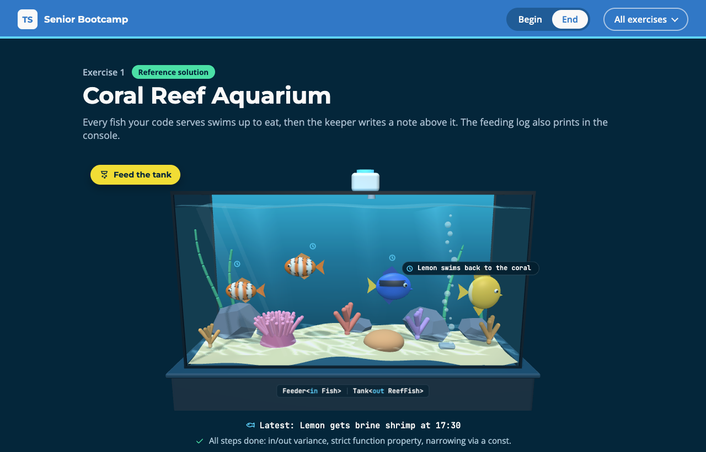

# Exercise 1 - Coral Reef Aquarium

---

⏰ 15 mins

---

<aside>
💡 If you haven’t already set up the boilerplate code, do so now with these instructions
</aside>

## What you will build

A reef tank where an automatic feeder drops flakes and a keeper writes a note about every fish. Once you are done, every fish swims up to eat, gets a correct note and is booked for tonight's treat. You practise variance annotations, the strict checking of function properties, and narrowing that does not survive into a callback.

## Before you start

1. Run `npm run dev` and open `/1-begin.html` in your browser.
2. Open `src/1-begin.ts`. Each step below matches a `// Step k` comment in the file. Everything else is already written. The fish types are in `src/_internal/reef-tank.ts`.

## Step 1 - Say which way the fish flow (5 mins)

A tank only hands fish out and a feeder only takes them in, so a feeder for any fish can feed a tank of reef fish, and never the reverse.

Add `out` to `Tank` and `in` to `Feeder`, then make `feedTank` serve every resident:

```typescript
export interface Tank<out T> {
  readonly residents: readonly T[]
}

export interface Feeder<in T> {
  // unchanged
}

export function feedTank<T>(tank: Tank<T>, feeder: Feeder<T>): string[] {
  return tank.residents.map(fish => ...)
}
```

<aside>
💡 HINT: Swap the two keywords and the compiler refuses with TS2636: `Type 'Tank<super-T>' is not assignable to type 'Tank<sub-T>' as implied by variance annotation.` The annotation must match how the type uses `T`.
</aside>

✅ **Check:** the four fish swim up to eat, and the plaque under the tank reads `Feeder<in Fish>` and `Tank<out ReefFish>`. The `step 1` tests pass (`npm test`). To see variance at work, try `feedTank(reef, pellets)`: the compiler refuses, because the tangs have no anemone.

## Step 2 - Make the keeper checked strictly (5 mins)

The tangs get the note `Azure hides in the undefined`, and the compiler said nothing. A method parameter is checked both ways, so `Keeper<Clownfish>` slips through as a `Keeper<ReefFish>`. A function property is checked strictly under `strictFunctionTypes`.

Turn `note` into a function property:

```typescript
export interface Keeper<T> {
  note: (fish: T) => string
}
```

The compiler now points at `onDuty`:

```
error TS2322: Type 'Keeper<Clownfish>' is not assignable to type 'Keeper<ReefFish>'.
```

Make `anemoneKeeper` a `Keeper<ReefFish>` and narrow on `fish.species`:

```typescript
note: fish => fish.species === 'clownfish'
  ? `${fish.name} hides in the ${fish.anemone}`
  : ... // `Azure swims back to the coral`
```

✅ **Check:** no note says `undefined` any more, and the `step 2` tests pass.

## Step 3 - Keep the narrowing inside the callback (5 mins)

Some evenings have no treat, so `plan.treat` is optional. The guard at the top of `treats` narrows it, but the callback of `map` runs later, and the compiler does not carry the narrowing of a property into it.

Map over `plan.tank.residents` and return `Sunny gets brine shrimp at 17:30` for each fish. Use `plan.treat.food` directly first, and read the error:

```
error TS18048: 'plan.treat' is possibly 'undefined'.
```

Then copy the value into a `const` before the guard, and narrow the `const`:

```typescript
const treat = plan.treat
if (treat === undefined) return []
return plan.tank.residents.map(fish => ...)
```

<aside>
💡 HINT: No `!` here. A non-null assertion silences the compiler, a `const` proves the value cannot change.
</aside>

✅ **Check:** the dot over every fish turns into a small clock for tonight's treat, and the `step 3` tests pass.

## Expected result



The tank shows four fed fish, each with a small clock for tonight's treat. The keeper's latest note, `Lemon swims back to the coral`, sits over the last fish, and the plaque reads `Feeder<in Fish>` and `Tank<out ReefFish>`. The console prints:

```
Sunny eats flakes
Pip eats flakes
Azure eats flakes
Lemon eats flakes
Sunny hides in the pink anemone
Pip hides in the pink anemone
Azure swims back to the coral
Lemon swims back to the coral
Sunny gets brine shrimp at 17:30
Pip gets brine shrimp at 17:30
Azure gets brine shrimp at 17:30
Lemon gets brine shrimp at 17:30
```

Run `npm test`: everything passes. The solution is in `src/1-end.ts`.

## Helpful Resources

1. [TypeScript Handbook - Type Compatibility](https://www.typescriptlang.org/docs/handbook/type-compatibility.html)
2. [TypeScript 4.7 Release Notes - Optional Variance Annotations for Type Parameters](https://www.typescriptlang.org/docs/handbook/release-notes/typescript-4-7.html#optional-variance-annotations-for-type-parameters)
3. [TypeScript 2.6 Release Notes - Strict function types](https://www.typescriptlang.org/docs/handbook/release-notes/typescript-2-6.html#strict-function-types)
4. [TypeScript Handbook - Narrowing](https://www.typescriptlang.org/docs/handbook/2/narrowing.html)
