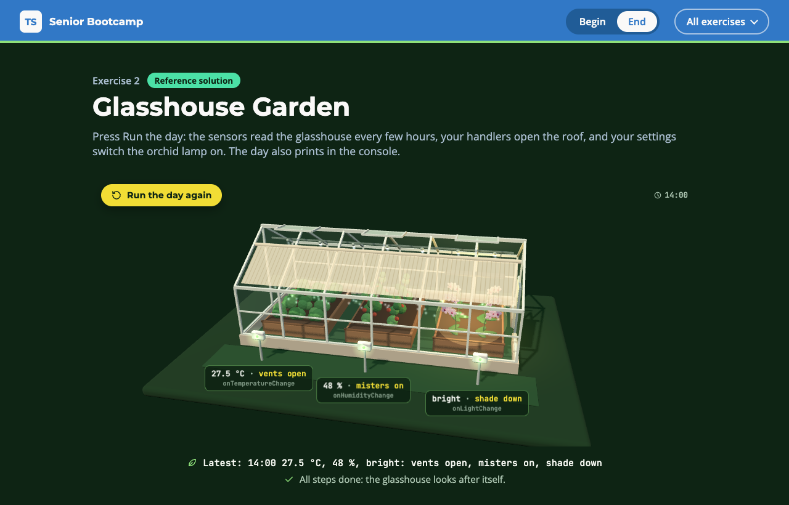

# Exercise 2 - Glasshouse Garden

---

⏰ 15 mins

---

<aside>
💡 If you haven’t already set up the boilerplate code, do so now with these instructions
</aside>

## What you will build

A glasshouse runs itself from its sensors. The page plays one day: the sensor tags show the types you compute, your handlers open the roof vents, run the misters and roll the shade down, and a deep patch switches the orchid lamp on. You practise `infer`, mapped types with key remapping, and a recursive type.

## Before you start

1. Run `npm run dev` and open `/2-begin.html` in your browser.
2. Open `src/2-begin.ts`. Each step below matches a `// Step k` comment in the file. Everything else is already written.

## Step 1 - Infer the readings (5 mins)

The sensors already say what they return, so the reading types should come from them, not be written twice.

Replace `ReadingOf` with a conditional type that infers the return type of a function. Then replace `Readings` with a mapped type over the keys of `Sensors` that applies `ReadingOf` to each one:

```typescript
export type ReadingOf<F> = F extends () => infer R ? ... : never

export type Readings = {
  [K in keyof Sensors]: ...
}
```

<aside>
💡 HINT: `ReadingOf<Sensors[keyof Sensors]>` gives `number | 'dim' | 'bright'`. A conditional type on a naked type parameter distributes over a union, one member at a time.
</aside>

✅ **Check:** the sensor tags show `number`, `number` and `'dim' | 'bright'` with their values, and the `step 1` tests pass (`npm test`).

## Step 2 - Remap the keys into handlers (5 mins)

A handler for each reading, with its name and its value type computed from `Readings`, can never drift from the sensors.

Replace `Handlers` with a mapped type that renames every key with `as`, from `temperature` to `onTemperatureChange`:

```typescript
export type Handlers<T> = {
  [K in keyof T as `on${Capitalize<K & string>}Change`]: ...
}
```

Save, and the compiler asks for the handlers:

```
error TS2739: Type '{}' is missing the following properties from type 'Handlers<Readings>': onHumidityChange, onLightChange, onTemperatureChange
```

Add one handler per sensor. Each `value` is already typed:

```typescript
export const handlers: Handlers<Readings> = {
  onTemperatureChange: (value) => glasshouse.vents(value > 25),
  // misters on below 55 %, shade down when it is 'bright'
}
```

<aside>
💡 HINT: `keyof T` can include `number` and `symbol` keys, and `Capitalize` only takes a `string`. `K & string` keeps the string keys.
</aside>

✅ **Check:** during the day, the shade rolls down at 11:00, and at 14:00 the vents open and the misters run. The `step 2` tests pass.

## Step 3 - Patch the settings deeply (5 mins)

`Partial` only makes the first level optional, so a patch deep inside the settings still has to spell out everything around it.

First pass the patch to `update`, and read the error:

```typescript
export const settings = update({ beds: { orchids: { lamp: { on: true, hours: 6 } } } })
```

```
error TS2739: Type '{ lamp: { on: true; hours: number; }; }' is missing the following properties from type 'Bed': plant, water
```

Then make `DeepPartial` recursive: every key optional, and an object value goes through `DeepPartial` again:

```typescript
export type DeepPartial<T> = {
  [K in keyof T]?: T[K] extends object ? ... : T[K]
}
```

<aside>
💡 HINT: A recursive type only unfolds as deep as the data goes. Here that is four levels, from `beds` to `on`.
</aside>

✅ **Check:** at the end of the day the orchid lamp lights up and the orchids bloom. The `step 3` tests pass.

## Expected result



The glasshouse ends the day at 14:00 with its vents open, the misters running, the shade down and the orchids blooming under their lamp. The console prints:

```
08:00 19.5 °C, 72 %, dim: vents closed, misters off, shade up
11:00 23 °C, 61 %, bright: vents closed, misters off, shade down
14:00 27.5 °C, 48 %, bright: vents open, misters on, shade down
Orchid lamp: on for 6 hours
```

Run `npm test`: everything passes. The solution is in `src/2-end.ts`.

## Helpful Resources

1. [TypeScript Handbook - Conditional Types](https://www.typescriptlang.org/docs/handbook/2/conditional-types.html)
2. [TypeScript Handbook - Inferring Within Conditional Types](https://www.typescriptlang.org/docs/handbook/2/conditional-types.html#inferring-within-conditional-types)
3. [TypeScript Handbook - Mapped Types, Key Remapping via as](https://www.typescriptlang.org/docs/handbook/2/mapped-types.html#key-remapping-via-as)
4. [TypeScript Handbook - Template Literal Types](https://www.typescriptlang.org/docs/handbook/2/template-literal-types.html)
