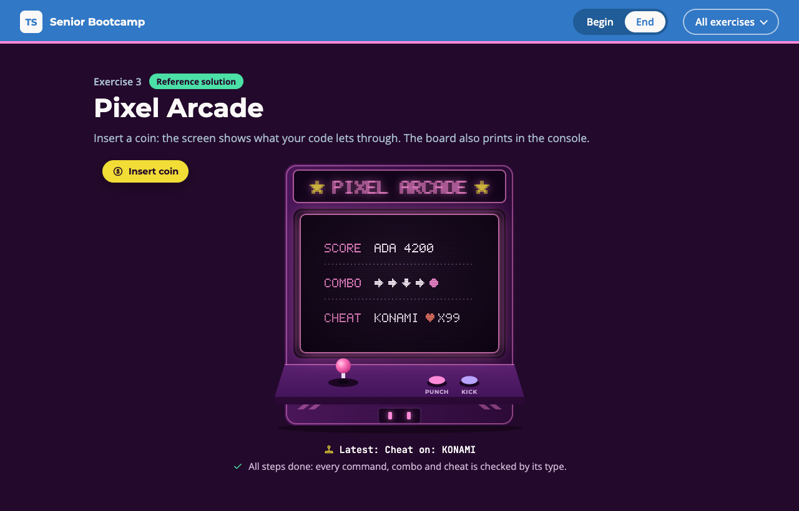

# Exercise 3 - Pixel Arcade

---

⏰ 15 mins

---

<aside>
💡 If you haven’t already set up the boilerplate code, do so now with these instructions
</aside>

## What you will build

An arcade cabinet reads score commands, plays move combos and accepts cheat codes. The screen lists the high scores, plays the combo on the joystick and lights the cheat once your types guard it. You practise template literal types with `infer`, an intrinsic string type, variadic and labelled tuples, and logic in the type system.

## Before you start

1. Run `npm run dev` and open `/3-begin.html` in your browser.
2. Open `src/3-begin.ts`. Each step below matches a `// Step k` comment in the file. Everything else is already written.

## Step 1 - Read the params of a command (5 mins)

The given `readCommand` is typed by `Params`, so once the compiler knows the names in a pattern, `score.player` can never be a typo.

Replace `ParamNames` with two template literal types: the first reads one `:name` followed by a `/` and recurses on the rest, the second reads the last name. Then write the body of `scoreLine`:

```typescript
export type ParamNames<Pattern extends string> =
  Pattern extends `${string}:${infer Name}/${infer Rest}`
    ? Name | ParamNames<Rest>
    : Pattern extends `${string}:${infer Name}`
      ? ...
      : never

// in scoreLine: the player in capitals, a space, the points
return `${score.player.toUpperCase()} ...`
```

<aside>
💡 HINT: Write `scoreLine` before `ParamNames` and the compiler says `Property 'player' does not exist on type 'Params<"/score/:player/:points">'`. That is `Params` built on `never`.
</aside>

✅ **Check:** the screen lists `ADA 4200`, `LIN 3900` and `BO 2750`, and the `step 1` tests pass (`npm test`).

## Step 2 - Join two combos into one tuple (5 mins)

A combo is an exact sequence of moves, so its type should keep every move in order, not flatten them into `Move[]`.

Write `Hadouken` as a labelled tuple, like the given `Dash`. Then make `combo` generic, with a variadic tuple as its return type:

```typescript
export type Hadouken = [down: 'down', /* forward, fire */]

export function combo<A extends readonly Move[], B extends readonly Move[]>(
  first: A,
  second: B,
): [...A, ...B] {
  return ...
}
```

<aside>
💡 HINT: Hover `combo(dash, hadouken)` in `board`: it should read `["right", "right", "down", "right", "punch"]`.
</aside>

✅ **Check:** the screen plays five moves while the joystick and the punch button follow them, and the `step 2` tests pass.

## Step 3 - Refuse bad cheat codes at compile time (5 mins)

`enterCheat` takes a `CheckCheat<Code>`, so the type you write decides which calls compile, and the message a caller sees when theirs does not.

Replace `CheckCheat` with the given `If` and `Equals` helpers. A code in capitals that is a `KnownCheat` gives back `Code`, any other code gives back a message:

```typescript
export type CheckCheat<Code extends string> =
  If<Equals<Code, Uppercase<Code>>,
    If<Code extends KnownCheat ? true : false,
      Code,
      `Unknown cheat code: ${Code}`>,
    `Cheat codes use capitals, try ${Uppercase<Code>}`>
```

Add `enterCheat('konami')` under `board`, then run `npm run typecheck`:

```
error TS2345: Argument of type '"konami"' is not assignable to parameter of type '"Cheat codes use capitals, try KONAMI"'.
```

Remove the line once you have read the message.

<aside>
💡 HINT: `enterCheat('KONAMI')` still compiles: `Code` is inferred from the argument, then checked by your type.
</aside>

✅ **Check:** the screen shows `KONAMI` with 99 lives and a pink frame, and the `step 3` tests pass.

## Expected result



The cabinet screen has one row per step: the high score ADA 4200, the five moves of the combo, and the KONAMI cheat with 99 lives. The console prints:

```
High score: ADA 4200
High score: LIN 3900
High score: BO 2750
Combo: right right down right punch
Cheat on: KONAMI
```

Run `npm test`: everything passes. The solution is in `src/3-end.ts`.

## Helpful Resources

1. [TypeScript Handbook - Template Literal Types](https://www.typescriptlang.org/docs/handbook/2/template-literal-types.html)
2. [TypeScript Handbook - Intrinsic String Manipulation Types](https://www.typescriptlang.org/docs/handbook/2/template-literal-types.html#intrinsic-string-manipulation-types)
3. [TypeScript 4.0 Release Notes - Variadic Tuple Types and Labeled Tuple Elements](https://www.typescriptlang.org/docs/handbook/release-notes/typescript-4-0.html)
4. [TypeScript Handbook - Conditional Types](https://www.typescriptlang.org/docs/handbook/2/conditional-types.html)
