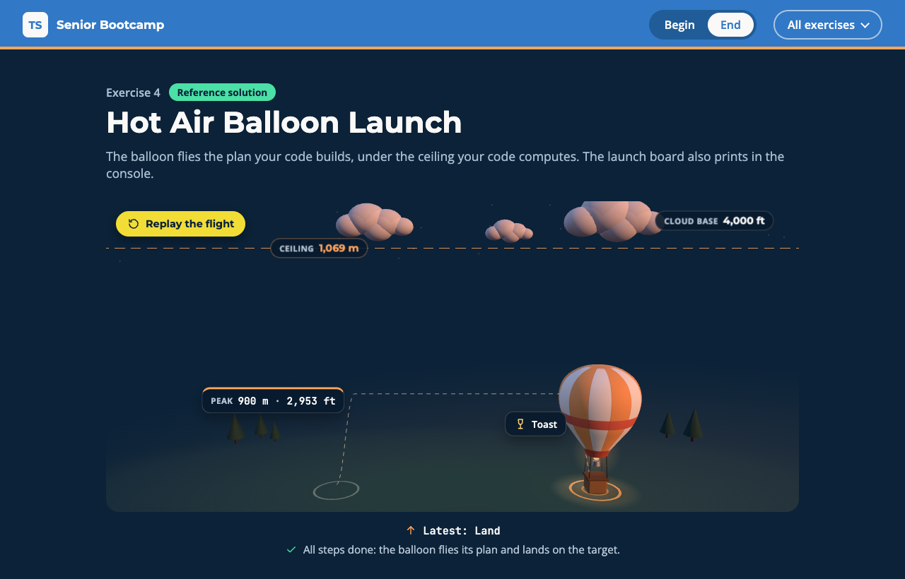

# Exercise 4 - Hot Air Balloon Launch

---

⏰ 15 mins

---

<aside>
💡 If you haven’t already set up the boilerplate code, do so now with these instructions
</aside>

## What you will build

A balloon crew plans tonight's sunset flight, and the met office reports the cloud base in feet. The page shows one balloon on the launch field: it flies the plan your code builds, under the ceiling your code computes. You practise branded types, polymorphic `this` in a fluent builder, and overloads.

## Before you start

1. Run `npm run dev` and open `/4-begin.html` in your browser.
2. Open `src/4-begin.ts`. Each step below matches a `// Step k` comment in the file. Everything else is already written.

## Step 1 - Brand the altitudes (5 mins)

`Metres` and `Feet` are both plain numbers, so nothing stops feet from going where metres are expected.

Brand each type with its own tag. Then make `metres` and `feet` the only way in: check the value with the given `isAltitude` predicate, and throw when it fails. The predicate narrows the number to the brand, so you never need `as`:

```typescript
export type Metres = number & { readonly __brand: 'Metres' }
export type Feet = ...

export function metres(value: number): Metres {
  if (!isAltitude<Metres>(value)) throw new RangeError(`Not an altitude: ${value}`)
  return value
}
```

Run `npm run typecheck`. The brands find a unit mix-up in the given code:

```
error TS2345: Argument of type 'Feet' is not assignable to parameter of type 'Metres'.
```

Convert the cloud base first with the given `toMetres`.

<aside>
💡 HINT: The ceiling should read 1,069 m. If it reads 3,850 m, the cloud base is still in feet.
</aside>

✅ **Check:** the dashed ceiling line drops under the clouds and reads `1,069 m`, and the `step 1` tests pass (`npm test`).

## Step 2 - Keep the subclass through the chain (5 mins)

A builder that returns its base class forgets every method a subclass adds.

Build tonight's plan in one chain: climb to 900 metres, drift for 20 minutes, toast at the top, then land. The compiler stops you at `toast`:

```
error TS2339: Property 'toast' does not exist on type 'FlightPlan'.
```

Change the return type of `climbTo`, `drift` and `land` from `FlightPlan` to `this`:

```typescript
climbTo(altitude: Metres): this {
  ...
}

export const plan = new SunsetFlight()
  .climbTo(metres(900))
  ...
```

✅ **Check:** the balloon takes off, drifts, toasts and lands on the target, and the `step 2` tests pass.

## Step 3 - Return the unit you ask for (5 mins)

`altitudeIn` returns `Metres | Feet` whatever you ask for, so every caller has to narrow it again.

Write two overload signatures above the implementation, one per unit. Then make the body return `toFeet(altitude)` when `unit` is `'feet'`:

```typescript
export function altitudeIn(unit: 'metres', altitude: Metres): Metres
export function altitudeIn(unit: 'feet', altitude: Metres): Feet
export function altitudeIn(unit: 'metres' | 'feet', altitude: Metres): Metres | Feet {
  ...
}
```

<aside>
💡 HINT: A generic with a conditional return type would also work for callers, but its body needs an `as`. Overloads keep the body honest.
</aside>

✅ **Check:** the peak card reads `900 m · 2,953 ft`, and the `step 3` tests pass.

## Expected result



The balloon has flown its plan: a dashed trail climbs to the peak, drifts under the ceiling, and comes down on the lit landing target. The ceiling reads in metres under a cloud base in feet, and the peak reads in both. The console prints:

```
Ceiling: 1069 m
Climb to 900 m (2953 ft)
Drift for 20 min
Toast at the top
Land
```

Run `npm test`: everything passes. The solution is in `src/4-end.ts`.

## Helpful Resources

1. [TypeScript Handbook - Using Type Predicates](https://www.typescriptlang.org/docs/handbook/2/narrowing.html#using-type-predicates)
2. [TypeScript Handbook - this Types](https://www.typescriptlang.org/docs/handbook/2/classes.html#this-types)
3. [TypeScript Handbook - Function Overloads](https://www.typescriptlang.org/docs/handbook/2/functions.html#function-overloads)
4. [TypeScript Handbook - Intersection Types](https://www.typescriptlang.org/docs/handbook/2/objects.html#intersection-types)
