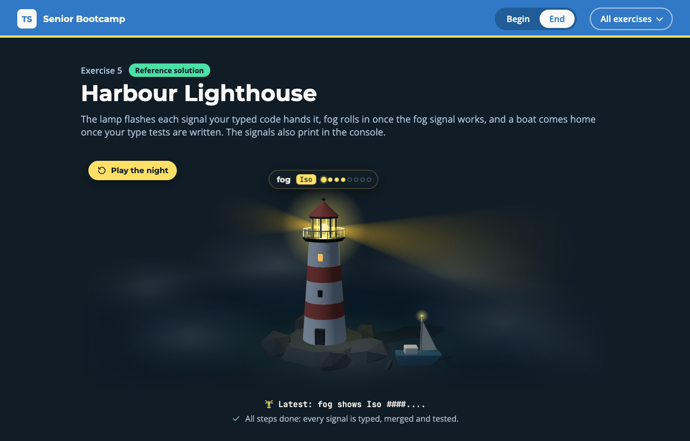

# Exercise 5 - Harbour Lighthouse

---

⏰ 15 mins

---

<aside>
💡 If you haven’t already set up the boilerplate code, do so now with these instructions
</aside>

## What you will build

The harbour's lighthouse runs on a lamp controller from 2011: a plain JavaScript script with no types. You write its declarations, add a fog signal without touching them, and prove the types with tests. The page shows the lighthouse flashing each signal of the night. You practise writing declarations, declaration merging and type tests.

## Before you start

1. Run `npm run dev` and open `/5-begin.html` in your browser.
2. Open `src/5-begin.ts`. Each step below matches a `// Step k` comment in the file. Everything else is already written.
3. Read the comment at the top of `src/_internal/beacon.js`: it describes the whole API of the lamp.

## Step 1 - Declare the vendor script (5 mins)

The script adds a `Beacon` global that TypeScript knows nothing about. Your declarations are the only thing standing between it and your code.

In the `beacon.d.ts` block, write a `Light<S>` type for what `flash` returns, then replace `unknown` with the two methods. Both are generic on the signal, so its character stays exact. Then make `shine` generic too:

```typescript
export type Light<S extends keyof Signals> = {
  signal: S
  character: Signals[S]
  pattern: string
}

declare const Beacon: {
  flash<S extends keyof Signals>(signal: S): ...
  register<...>(signal: S, character: ...): void
}

export function shine<S extends keyof Signals>(signal: S): Light<S> {
  return ...
}
```

<aside>
💡 HINT: `Signals[S]` is an indexed access type. For `'storm'`, it gives `'Q'`, not `string`.
</aside>

✅ **Check:** the lamp lights up and flashes harbour, ship and storm, and the `step 1` tests pass (`npm test`).

## Step 2 - Add the fog signal (5 mins)

The `beacon.d.ts` block is published: you never edit it. You extend it from your own code instead.

Below the block, call `Beacon.register('fog', 'Iso')`. The compiler refuses it:

```
error TS2345: Argument of type '"fog"' is not assignable to parameter of type 'keyof Signals'.
```

Reopen the interface under the call. Declaration merging adds `fog` to the published `Signals`:

```typescript
export interface Signals {
  fog: ...
}
```

<aside>
💡 HINT: Merging only changes the types. The lamp learns about fog when `register` runs, so keep the call. In a separate file, the same merge is written inside `declare module '...' { }`: that is module augmentation.
</aside>

✅ **Check:** fog rolls in and the lamp shows `Iso`, and the `step 2` tests pass.

## Step 3 - Test your types (5 mins)

Runtime tests can't see a type. Type tests make the compiler check your declarations every time you run `npm test`.

Open `tests/5-begin.test-d.ts`. Write two `expectTypeOf` checks, one for `fog` and one for another signal, and one call that must not compile:

```typescript
expectTypeOf(shine('fog').character).toEqualTypeOf<...>()
expectTypeOf(...).toEqualTypeOf<...>()

// @ts-expect-error hurricane is not one of the Signals
shine('hurricane')
```

<aside>
💡 HINT: If the line under `@ts-expect-error` compiles, the directive itself fails with `TS2578: Unused '@ts-expect-error' directive.` That is how the test catches a declaration that got too loose.
</aside>

✅ **Check:** a boat comes home to the islet, and the `step 3` tests pass.

## Expected result



The lighthouse flashes harbour, ship, storm and then fog, each in its own rhythm. Fog drifts over the water, and a boat is moored by the rocks. The console prints:

```
harbour shows Fl #.......
ship shows Oc ######..
storm shows Q #.#.#.#.
fog shows Iso ####....
```

Run `npm test`: everything passes. The solution is in `src/5-end.ts` and `tests/5-end.test-d.ts`.

## Helpful Resources

1. [TypeScript Handbook - Declaration Reference](https://www.typescriptlang.org/docs/handbook/declaration-files/by-example.html)
2. [TypeScript Handbook - Declaration Merging](https://www.typescriptlang.org/docs/handbook/declaration-merging.html)
3. [TypeScript Handbook - Module Augmentation](https://www.typescriptlang.org/docs/handbook/declaration-merging.html#module-augmentation)
4. [Vitest - Testing Types](https://vitest.dev/guide/testing-types)
