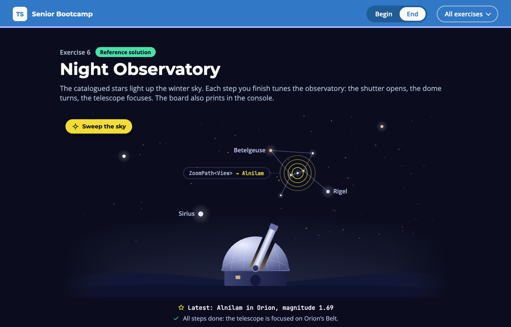

# Exercise 6 - Night Observatory

---

⏰ 15 mins

---

<aside>
💡 If you haven’t already set up the boilerplate code, do so now with these instructions
</aside>

## What you will build

The observatory's catalogue code already works, but it is costly to check. You tune it with three classic compiler fixes, and you measure each one: the shutter opens, the dome turns towards Orion, and the telescope focuses on Orion's Belt. You practise interfaces over intersections, explicit types for `isolatedDeclarations`, and a depth limit on a recursive type.

## Before you start

1. Run `npm run dev` and open `/6-begin.html` in your browser.
2. Open `src/6-begin.ts`. Each step below matches a `// Step k` comment in the file. Everything else is already written.
3. Run `npm run check:6`. It checks your file with `isolatedDeclarations` on (`tsconfig.exercise-6.json`), then prints the compiler's counters. Note the `Types` and `Instantiations` lines: you compare them after each step.

## Step 1 - Turn the intersection into an interface (5 mins)

The compiler caches a named interface and checks its `extends` list once. An intersection is rebuilt wherever it is used, and two pieces that disagree on a property quietly produce `never` instead of an error.

Replace the `Star` intersection with one interface that extends the four pieces. The body stays empty: every member comes from the pieces.

```typescript
export interface Star extends Identity, ... {}
```

<aside>
💡 HINT: Run `npm run check:6` again. On a file this small the counters do not move (9891 types before and after). The gain shows once the type is used in many places: at the end of the exercise, the intersection still costs 14 more types than the interface.
</aside>

✅ **Check:** the dome's shutter opens, and the `step 1` tests pass (`npm test`).

## Step 2 - Write the type of every export (5 mins)

With `isolatedDeclarations`, each exported signature is written in the file itself. A tool can then produce a file's `.d.ts` without checking its neighbours, so builds can work on many files in parallel.

`npm run check:6` lists the exports it cannot describe on its own:

```
error TS9013: Expression type can't be inferred with --isolatedDeclarations.
error TS9010: Variable must have an explicit type annotation with --isolatedDeclarations.
error TS9017: Only const arrays can be inferred with --isolatedDeclarations.
```

Add the missing types. `describe` and `focus` already show the way:

```typescript
export function brightest(list: readonly Star[]): ... {
export function inConstellation(list: readonly Star[], name: string): ... {
export const catalogue: ... = [...stars].sort(...)
export function board(): ... {
```

✅ **Check:** `npm run check:6` prints no error, the dome turns and the telescope rises, and the `step 2` tests pass.

## Step 3 - Put a depth limit on a recursive type (5 mins)

`ZoomPath<View>` lists every dotted path through a view, such as `'zoom.star.name'`. But a `View` contains a `View`, so the list never ends.

First, type the `path` parameter of `focus` as `ZoomPath<View>` instead of `string`. The compiler gives up on that line, and `npm run check:6` shows `Instantiations` going from 6930 to 11307:

```
error TS2589: Type instantiation is excessively deep and possibly infinite.
```

Then add a `Depth` counter to `ZoomPath`. Each level adds one element to the tuple, and the type stops at 4:

```typescript
export type ZoomPath<
  T, Prefix extends string = '', Depth extends unknown[] = []
> =
  Depth['length'] extends 4
    ? never
    : T extends object
      ? ... // the mapped type you already have
      : never

// and in the recursive call:
ZoomPath<T[K], `${Prefix}${K}.`, [...Depth, unknown]>
```

<aside>
💡 HINT: A tuple is a counter the compiler can read: the `length` of `[unknown, unknown]` is the literal type `2`.
</aside>

✅ **Check:** TS2589 is gone, `Instantiations` drops to 7578, and a typo such as `'zoom.star.nmae'` no longer compiles. The telescope focuses on Alnilam, and the `step 3` tests pass.

## Expected result



The winter sky shows the ten catalogued stars and the figure of Orion. The dome is open and turned, the telescope points at Orion's Belt, and four yellow rings, one per level of `ZoomPath`, frame Alnilam. A small tag names the idea behind the latest change: `interface Star extends …` by the open shutter, `isolatedDeclarations` once the dome turns, and here `ZoomPath<View> → Alnilam`. The console prints:

```
10 stars catalogued
Brightest: Sirius in Canis Major, magnitude -1.46
Orion: Rigel, Betelgeuse, Bellatrix, Alnilam, Alnitak, Saiph, Mintaka
Latest: Alnilam in Orion, magnitude 1.69
```

The counters of `npm run check:6`, measured with TypeScript 7.0.2 on this repository (yours may differ by a few if you write the types differently):

| State | Errors | Types | Instantiations |
| --- | --- | --- | --- |
| Starting point | 4 (isolatedDeclarations) | 9891 | 6934 |
| After steps 1 and 2 | 0 | 9893 | 6930 |
| `focus` takes `ZoomPath<View>`, no limit | 1 (TS2589) | 10680 | 11307 |
| After step 3 | 0 | 10103 | 7578 |

Run `npm test`: everything passes. The solution is in `src/6-end.ts`.

## Helpful Resources

1. [TypeScript Wiki - Performance: Preferring Interfaces Over Intersections](https://github.com/microsoft/TypeScript/wiki/Performance#preferring-interfaces-over-intersections)
2. [TypeScript 5.5 Release Notes - Isolated Declarations](https://www.typescriptlang.org/docs/handbook/release-notes/typescript-5-5.html#isolated-declarations)
3. [TSConfig Reference - isolatedDeclarations](https://www.typescriptlang.org/tsconfig/#isolatedDeclarations)
4. [TypeScript Wiki - Performance: extendedDiagnostics](https://github.com/microsoft/TypeScript/wiki/Performance#extendeddiagnostics)
5. [TypeScript Handbook - Template Literal Types](https://www.typescriptlang.org/docs/handbook/2/template-literal-types.html)
