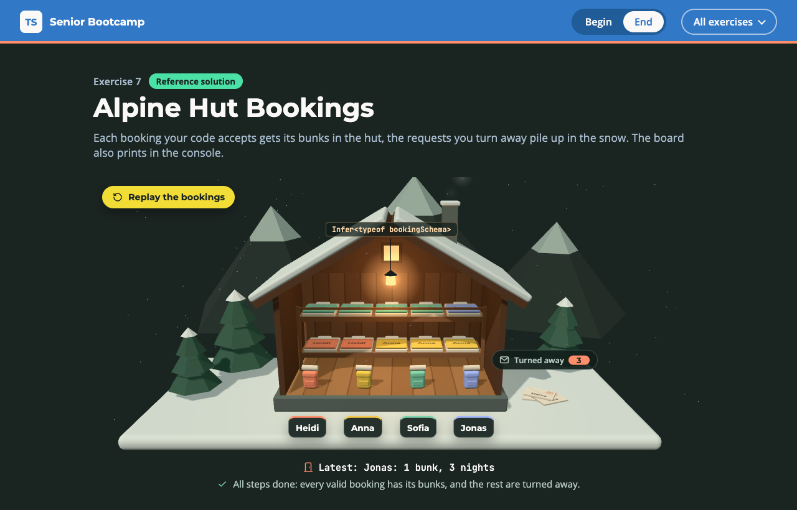

# Exercise 7 - Alpine Hut Bookings

---

⏰ 15 mins

---

<aside>
💡 If you haven’t already set up the boilerplate code, do so now with these instructions
</aside>

## What you will build

A mountain hut receives its booking requests as raw JSON, and some of them are broken. The page shows the hut: every valid booking leaves a backpack on the porch and fills its bunks, and the requests you turn away pile up in the snow. You practise the line between types and runtime: a type inferred from a schema, parsing at the boundary, and typing a legacy JavaScript helper during a migration.

## Before you start

1. Run `npm run dev` and open `/7-begin.html` in your browser.
2. Open `src/7-begin.ts`. Each step below matches a `// Step k` comment in the file. Everything else is already written.

## Step 1 - Infer the booking type from the schema (5 mins)

A schema checks data at runtime, a type checks code at compile time. Write the shape once and derive the other, so they can never drift apart. The hand-written `Booking` already has: it says `people`, the schema says `party`.

`bookingSchema` is given. Replace the `Infer` placeholder with a conditional type that reads `T` out of a `Schema<T>`, then compute `Booking` from the schema:

```typescript
export type Infer<S> = S extends Schema<infer T> ? ... : never

export type Booking = Infer<typeof bookingSchema>
```

<aside>
💡 HINT: Hover `Booking` in your editor. You should see `{ guest: string; party: number; nights: number; }`.
</aside>

✅ **Check:** the hut lights up (lantern, window and chimney smoke), and the `step 1` tests pass (`npm test`).

## Step 2 - Parse at the boundary (5 mins)

The requests are plain text from outside. `JSON.parse` returns `any`, which would switch the compiler off. Keep its result as `unknown`, and only hand out a `Booking` once the schema has checked it: parse, don't validate.

Write `parseBooking`. Return a failed `Result` when the JSON is broken, otherwise return what the schema finds:

```typescript
export function parseBooking(json: string): Result<Booking> {
  let data: unknown
  try {
    data = JSON.parse(json)
  } catch {
    return { ok: false, errors: [...] }
  }
  return ...
}
```

<aside>
💡 HINT: `bookingSchema.parse(data)` already returns a `Result<Booking>`, with readable errors such as `party: expected a number, got string`.
</aside>

✅ **Check:** Heidi, Anna, Sofia and Jonas leave a backpack on the porch, three requests pile up in the snow, and the `step 2` tests pass. The bunks are still empty.

## Step 3 - Type the legacy helper (5 mins)

`assignBunks` comes from the hut's old `hut.js`. It was ported with a first-pass type, `Record<string, unknown>`, which lets any field name through. That is how a bug survives a migration.

Change the parameter type to `readonly Booking[]`, then run `npm run typecheck`:

```
error TS2339: Property 'people' does not exist on type '{ guest: string; party: number; nights: number; }'.
```

Read `booking.party` instead. Once the parameter is typed, `Number(...)` and `String(...)` are no longer needed either:

```typescript
for (let i = 0; i < booking.party; i++) {
  if (bunks.length < capacity) bunks.push(...)
}
```

✅ **Check:** every bunk gets a blanket with its guest's name, and the `step 3` tests pass.

## Expected result



The hut is lit and shows `Infer<typeof bookingSchema>` on its gable, its ten bunks carry the names of Heidi, Anna, Sofia and Jonas, and three requests lie in the snow. The console prints:

```
Heidi: 2 bunks, 1 night
Request 2 turned away: party: expected a number, got string
Anna: 3 bunks, 2 nights
Request 4 turned away: not valid JSON
Sofia: 4 bunks, 1 night
Request 6 turned away: party: expected a number, got undefined
Jonas: 1 bunk, 3 nights
Bunks taken: 10 of 10
```

Run `npm test`: everything passes. The solution is in `src/7-end.ts`.

## Helpful Resources

1. [TypeScript Handbook - Inferring Within Conditional Types](https://www.typescriptlang.org/docs/handbook/2/conditional-types.html#inferring-within-conditional-types)
2. [TypeScript Handbook - The unknown Type](https://www.typescriptlang.org/docs/handbook/2/functions.html#unknown)
3. [Alexis King - Parse, don't validate](https://lexi-lambda.github.io/blog/2019/11/05/parse-don-t-validate/)
4. [TypeScript Handbook - Migrating from JavaScript](https://www.typescriptlang.org/docs/handbook/migrating-from-javascript.html)
